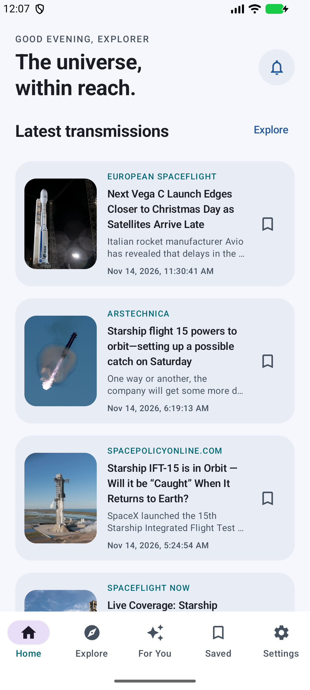
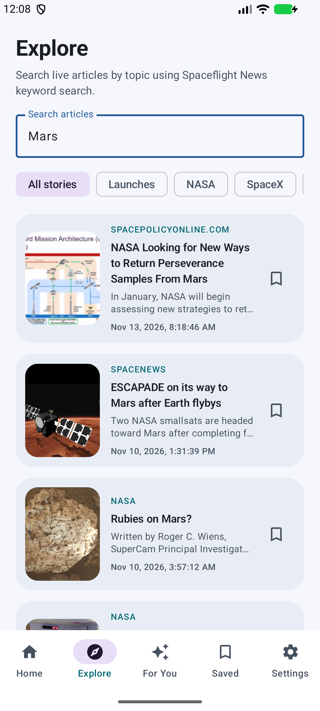
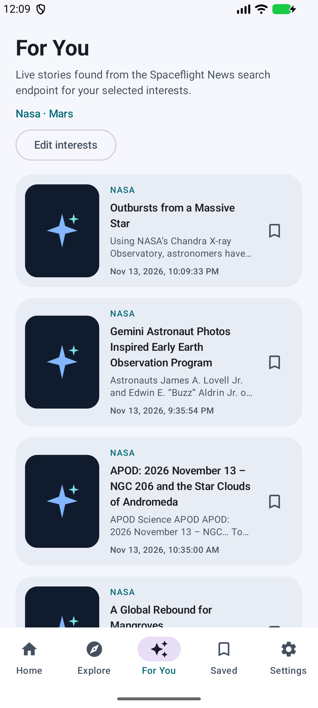
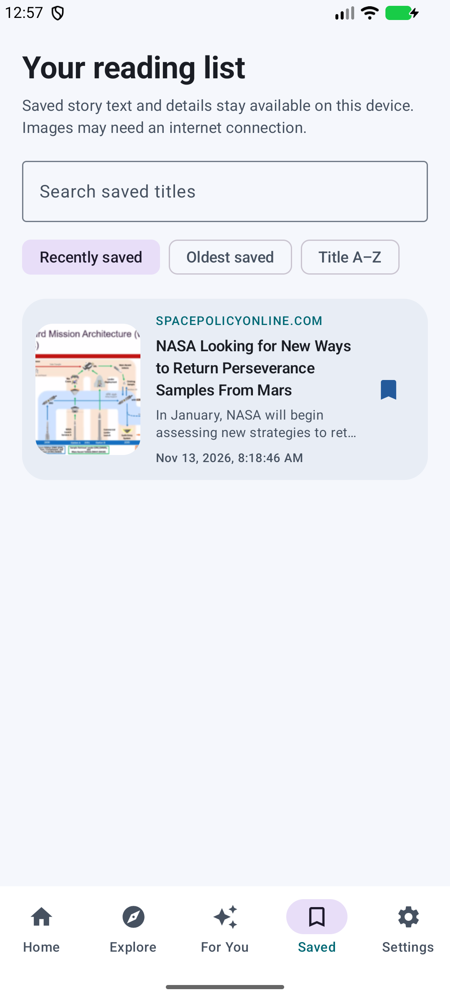
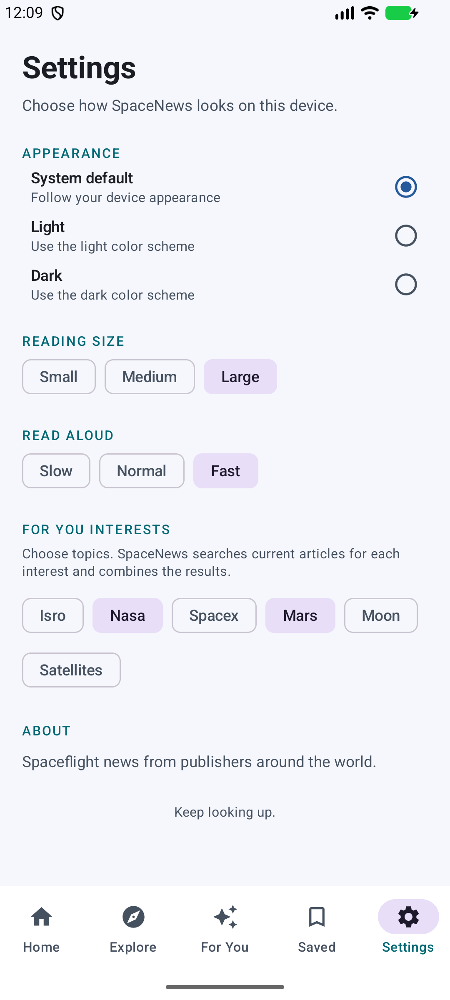
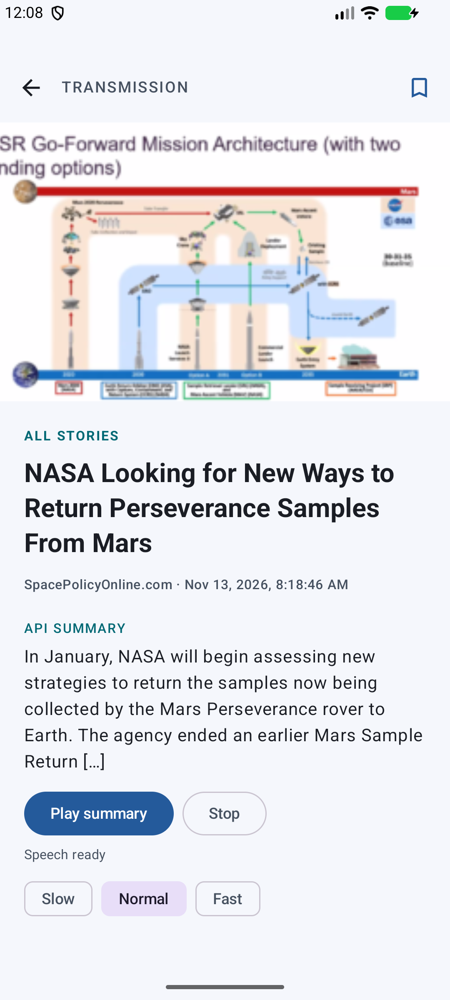

# SpaceNews

SpaceNews is a Kotlin and Jetpack Compose reader for current spaceflight news. It uses the Spaceflight News API to find articles and Room to keep a local reading list.

## Features

- Live Home feed with publisher, publication date, and article image.
- Explore with keyword search and named topic searches (All stories, Launches, NASA, SpaceX, Astronomy). The API provides a general `search` parameter rather than topic-category fields.
- Article detail pages with a clearly labeled API summary and a link to the publisher’s original article.
- For You interest feed. Selected interests (ISRO, NASA, SpaceX, Mars, Moon, satellites) are matched through API search requests, then merged and deduplicated. This is rule-based interest matching, not trained AI.
- Pull to refresh, API-provided next-page pagination, retry states, and duplicate prevention.
- Room bookmarks with locally saved article text/details, bookmark search, and recently saved / oldest saved / title sorting. Images are shown through Glide when available; offline image caching is not promised.
- Adjustable reading size and Android TextToSpeech controls for the available summary.
- Persisted system/light/dark theme preference.

## Stack

- Kotlin, Android Gradle Plugin, Jetpack Compose and Material 3
- Retrofit, Gson and OkHttp for HTTPS API calls
- Glide Compose for article images
- Room and Kotlin Flow for bookmarks
- ViewModels, coroutines and SharedPreferences for UI state and preferences
- Android TextToSpeech for summary playback

## Architecture

`SpaceflightNewsApi` describes API endpoints and DTOs. `NewsRepository` maps optional API fields to the app’s `Article` model and follows the API’s `next` URL. `NewsViewModel` owns feed, search, pagination, details, and bookmark actions. `BookmarkRepository` and `BookmarkDao` persist saved `Article` records in the application-scoped Room database. `ThemePreferences` stores observable settings, while `SettingsViewModel` exposes them to Compose. Screens and bottom navigation are in `NewsScreens.kt` and `SpaceNewsApp.kt`.

The API’s `/articles/` endpoint returns a paginated `{count,next,previous,results}` envelope. Article records include `id`, `title`, `summary`, `image_url`, `news_site`, `published_at`, and `url`; the app treats optional/missing values safely. Explore and interest feeds use the endpoint’s documented `search` parameter. `next` is followed as returned by the API. See the [official API docs](https://api.spaceflightnewsapi.net/v4/docs/) and [official OpenAPI schema](https://api.spaceflightnewsapi.net/v4/schema/).

## Run in Android Studio

1. Open the project root directory in Android Studio.
2. Let Gradle sync. Keep `local.properties` local; it contains the machine-specific Android SDK path.
3. Select an emulator or Android device with network access and press **Run** for `app`.
4. To build from a terminal, run `./gradlew :app:assembleDebug`. The debug APK is created at `app/build/outputs/apk/debug/app-debug.apk`.

The app requires internet access for live news and remote images. Previously saved article text/details are local and can be opened without a network connection; the original article link and uncached images require connectivity.

## Screenshots

Real emulator screenshots captured during verification:

- Home feed: 
- Explore search: 
- For You: 
- Saved list: 
- Settings: 
- Article details and read-aloud controls: 

See [demo steps](docs/DEMO_CHECKLIST.md), [viva guide](docs/VIVA_GUIDE.md), and [test results](docs/TEST_RESULTS.md).
